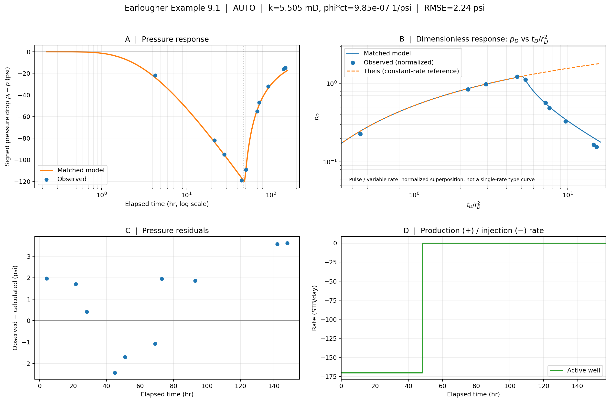

# Interference Testing

Analytical interference-test simulation with **manual forward modelling** and **automatic history matching** from the same CSV interface. Set `run_mode` in `inputs.csv` to `manual` (use your own parameters without optimization) or `auto` (fit parameters to observed pressure). If `run_mode` is omitted, existing cases default to `auto`. Pressure drop is: `dp_psi = initial reservoir pressure - measured pressure`.



## Install

From the repository root in a terminal (Python 3.10 or newer):

```powershell
python -m pip install -e .
```

## Run and display a case

```powershell
python examples/run.py earlougher_9_1
python examples/run.py earlougher_9_2
```

The program **saves a PNG and TXT summary and opens the figure by default**. Close the plot window to return to the terminal. On a headless backend it still saves the PNG. To save without opening a plot window:

```powershell
python examples/run.py earlougher_9_1 --no-show
```

To list cases or run all included examples:

```powershell
python examples/run.py --list
python examples/run.py --all
```

## Run your own case outside the repository

Keep four files in any directory, for example `C:\well-tests\my_test\`, and run:

```powershell
python examples/run.py --case-dir "C:\well-tests\my_test"
```

The figure and summary are written into that case folder's `results/` subfolder.

## Input files

Each case needs three CSV files. A fourth (`pressure.csv`) is required only for `auto` mode or for comparing manual predictions against observations:

| File | Columns | Meaning |
| --- | --- | --- |
| `inputs.csv` | `parameter,value,description` | Human-readable case settings; `description` is optional |
| `wells.csv` | `well,role,x_ft,y_ft,rw_ft` | One `active` and one `observation` well; coordinates and optional radius in ft |
| `rates.csv` | `well,time_hr,rate_stbd` | Active well's piecewise-constant **rate levels**, not rate increments; positive = production |
| `pressure.csv` (optional in `manual`) | `well,time_hr,dp_psi` | Observation-well signed pressure drop in psi |

`time_hr` is elapsed hours since the same time origin in both CSVs.

## Validation and numerical boundaries

Before either mode runs, the runner verifies finite and physically positive fluid/reservoir properties, well separation and radii, finite pressure samples, strictly increasing nonnegative times, nonzero production/injection schedule, compatible boundary geometry, and model-specific inputs. Fitting routines bound permeability and storativity to broad positive numerical ranges; advanced models also bound their additional fitted parameters. These are **numerical safeguards**, not evidence that fitted parameters are uniquely constrained. RMSE alone does not validate the selected reservoir model.

For **variable-rate tests**, the second panel displays pressure residuals because conventional constant-rate type-curve scaling would be misleading after shut-in. For one constant rate the second panel displays a dimensionless type-curve comparison.

## Citation

If you use this repository in your research or technical work, please consider citing the following published paper, which demonstrates the application of interference testing to a geothermal doublet case.

Sengel, A. (2025). Interference Testing: Theory and Application in Geothermal Energy. Sixth EAGE Global Energy Transition Conference & Exhibition (GET 2025). https://doi.org/10.3997/2214-4609.202521057

## References

Earlougher, R. C., Jr. (1977). Advances in Well Test Analysis. SPE Monograph Vol. 5.
Hantush, M. S., & Jacob, C. E. (1955). Non-Steady Radial Flow in an Infinite Leaky Aquifer. Transactions, American Geophysical Union, 36(1), 95–100. https://doi.org/10.1029/TR036i001p00095
Sandal, H. M., et al. (1978). Interference Testing With Wellbore Storage and Skin Effect at the Produced Well. SPE Annual Technical Conference and Exhibition, Houston, Texas, SPE-7454-MS.
Stehfest, H. (1970). Algorithm 368: Numerical Inversion of Laplace Transforms [D5]. Communications of the ACM, 13(1), 47–49. https://doi.org/10.1145/361953.361969
Theis, C. V. (1935). The Relation Between the Lowering of the Piezometric Surface and the Rate and Duration of Discharge of a Well Using Ground-Water Storage. Transactions, American Geophysical Union, 16(2), 519–524. https://doi.org/10.1029/TR016i002p00519
Tongpenyai, Y., & Raghavan, R. (1981). The Effect of Wellbore Storage and Skin on Interference Test Data. Journal of Petroleum Technology, 33(1), 151–160. https://doi.org/10.2118/8863-PA
Warren, J. E., & Root, P. J. (1963). The Behavior of Naturally Fractured Reservoirs. Society of Petroleum Engineers Journal, 3(3), 245–255. https://doi.org/10.2118/426-PA
